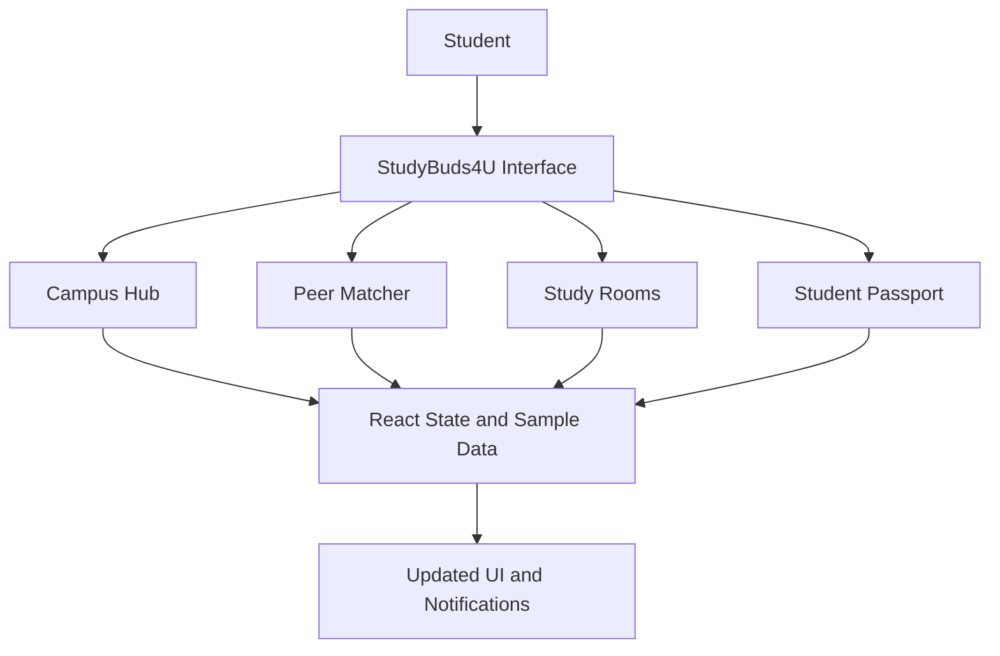

# StudyBuds4U 🎓

### Learn Together. Teach Each Other. Grow Together.

**StudyBuds4U** is a peer-learning collaboration prototype designed to help students discover study partners, exchange academic skills, and explore collaborative study sessions.

🔗 **Live Demo:** https://studybuds4u.netlify.app/  
💻 **GitHub Repository:** https://github.com/mayankmalik08/studybuds4u

---

## 📌 Problem Statement

Students can struggle to find the right people to study with, especially when they need help with a particular subject but have skills that could benefit someone else.

Traditional study methods do not always make it easy to discover compatible learning partners or organize peer-to-peer learning opportunities.

**The challenge:** How might we make collaborative learning easier by connecting students through complementary academic strengths and learning needs?

## 💡 Our Solution

StudyBuds4U explores a student-centered approach to collaborative learning, bringing peer discovery, skill exchange, and study-session discovery into one interface.

The goal is to make it easier for students to identify potential study partners, share what they can teach, and find opportunities to learn together.

## ✨ Key Features

- **Campus Hub:** A central dashboard presenting student reputation points, study-room listings, and a sample match indicator.
- **Peer Matcher:** Browse sample student profiles, review their academic strengths and learning needs, and choose to connect or skip.
- **Skill Exchange:** Represent subjects a student can teach alongside subjects they need help with.
- **Study Rooms:** Explore predefined study-session listings organized around academic topics.
- **Student Passport:** Edit a sample student profile, including academic year, branch, teaching skills, and learning needs.
- **Gamification:** Earn demonstration points through the peer-connection interaction.

> **Prototype note:** The current version uses predefined demonstration data and client-side state. Connection requests, study-room joins, match percentages, and profile updates are illustrative interactions, not evidence of a production backend or live matching service.

## 🎯 Target Users

- College students looking for academic study partners.
- Students who want to exchange knowledge and skills with peers.
- Learners interested in collaborative preparation for assignments and examinations.
- Student communities exploring peer-led learning.

## ⚙️ How It Works

1. **Explore the hub:** View the dashboard and available demonstration features.
2. **Discover peers:** Browse sample student profiles and their listed skills.
3. **Choose a study partner:** Connect with a suggested profile or skip to another.
4. **Explore study rooms:** Review sample academic sessions and try the join interaction.
5. **Update your profile:** Edit the displayed academic details and skill preferences.

The current implementation demonstrates the interface and interaction flow using local React state and sample data.

## 🛠️ Technology Stack

| Technology | Purpose |
|---|---|
| React 19 | Builds the component-based user interface. |
| React DOM | Renders React components in the browser. |
| JavaScript (ES modules) | Implements application logic and interactions. |
| Vite | Provides the development server and production build tooling. |
| CSS-in-JS (inline styles) | Defines component appearance and layout directly in JSX. |
| Oxlint | Provides code linting. |
| Netlify | Hosts the live demonstration website. |

The current prototype uses React state to manage the active view, sample peer profiles, profile edits, points, and notifications. Its peer-match percentages are predefined demonstration values, not outputs from a verified AI model.

## 🏗️ Application Architecture

The current prototype follows a frontend-focused architecture.



**Current implementation:**
- The frontend renders the available views and interface components.
- React state manages interactions during the current session.
- Sample profiles and study rooms are defined in the application code.
- The deployed website is available through Netlify.

**Not yet implemented in this prototype:** persistent user accounts, a shared database, real-time collaboration, and a verified AI-based recommendation engine.

## 🚀 Getting Started

### Prerequisites

Install [Node.js](https://nodejs.org/) and npm.

### Installation

Clone the repository:

```bash
git clone https://github.com/mayankmalik08/studybuds4u.git
cd studybuds4u
```

Install dependencies:

```bash
npm install
```

Start the development server:

```bash
npm run dev
```

Open the local URL displayed in your terminal.

### Production Build

Create a production build:

```bash
npm run build
```

Preview the production build locally:

```bash
npm run preview
```

Run the configured linter:

```bash
npm run lint
```

## 📁 Project Structure

```text
studybuds4u/
├── public/              # Public static assets
├── src/                 # Application source code
│   └── App.jsx          # Main application interface and interactions
├── index.html           # HTML entry point
├── package.json         # Dependencies and npm scripts
├── package-lock.json    # Dependency lockfile
├── vite.config.js       # Vite configuration
├── netlify.toml         # Netlify configuration
└── README.md            # Project documentation
```

## 🔭 Future Scope

Potential improvements include:

- **Real peer matching:** Recommend study partners based on complementary skills, academic interests, and learning goals.
- **User authentication:** Support individual student accounts and secure profiles.
- **Persistent storage:** Save profiles, connections, and study-room information across sessions.
- **Collaborative study sessions:** Introduce shared workspaces and communication features.
- **Transparent recommendations:** Explain why a particular peer is recommended and allow students to control their preferences.
- **Progress tracking:** Track learning goals and participation using meaningful, user-controlled indicators.

These are proposed enhancements, not claims about current functionality.

## 🧪 Current Limitations

- Uses predefined sample profiles and study-room listings.
- Does not currently provide persistent database storage.
- Connection and room-joining actions are simulated in the interface.
- Match percentages are illustrative rather than calculated by a verified recommendation algorithm.
- The current prototype does not establish real-time communication between students.

## 🤝 Contributing

Contributions and suggestions are welcome. You can fork the repository, create a branch for your changes, and submit a pull request.

## 📄 License

No license has been specified yet. Add an appropriate `LICENSE` file before declaring the project open source.

---

**StudyBuds4U — making peer learning easier to explore, one connection at a time.**
